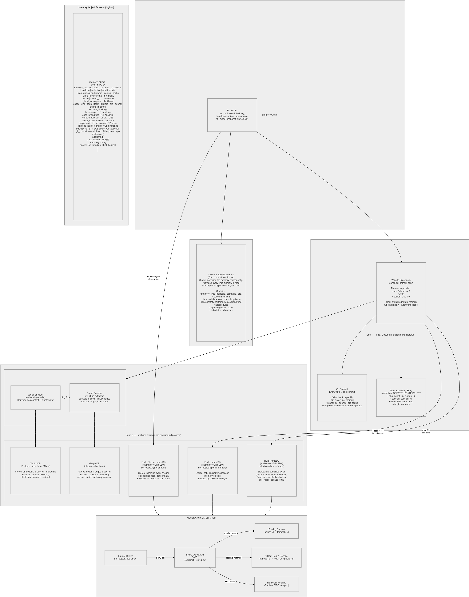

# Deployment

This page covers:

* the databases for [Agentic Memory](agentic-memory.md) (PostgreSQL, Weaviate, ArangoDB, Redis) on Kubernetes;
* running the [Learner](learner.md) and [Incorporator](incorporator.md) services;
* running the test suites.



[Download Image](../../images/advanced-memories/memory-storage.png)

---

## Databases on Kubernetes

The manifests in `agent-memories/k8s/` run all four databases in the `agentic-memory` namespace and expose them through `NodePort` services:

| Database | Manifest | Image | Workload | Container port | NodePort | Persistent volume |
|---|---|---|---|---|---|---|
| PostgreSQL | `postgres.yaml` | `postgres:16` | StatefulSet | 5432 | 30432 | `postgres-pvc` (10 Gi) |
| ArangoDB | `arango.yaml` | `arangodb:3.12` | StatefulSet | 8529 | 30529 | `arango-pvc` (10 Gi) |
| Weaviate | `weaviate.yaml` | `semitechnologies/weaviate:1.25.0` | StatefulSet | 8080 (HTTP), 50051 (gRPC) | 30880, 30851 | `weaviate-pvc` (10 Gi) |
| Redis | `redis.yaml` | `redis:7` | Deployment | 6379 | 30637 | none (data is not persisted) |

Weaviate runs with anonymous access and no vectorizer module: Agentic Memory supplies its own embeddings. PostgreSQL, ArangoDB and Redis read their passwords from the `postgres-secret`, `arango-secret` and `redis-secret` Secrets defined in the manifests.

### Steps

1. Create the host directories used by the `hostPath` volumes (on the node):

    ```bash
    mkdir -p /data/agentic-memory/{postgres,arango,weaviate}
    ```

2. **Change the passwords** in the Secrets in `postgres.yaml`, `arango.yaml` and `redis.yaml`.

3. Apply the manifests. Volumes go first, so the StatefulSets can bind their claims:

    ```bash
    kubectl create namespace agentic-memory   # the manifests don't create the namespace
    kubectl apply -f k8s/pv-pvc.yaml
    kubectl apply -f k8s/postgres.yaml
    kubectl apply -f k8s/arango.yaml
    kubectl apply -f k8s/weaviate.yaml
    kubectl apply -f k8s/redis.yaml
    kubectl get pods -n agentic-memory -w
    ```

4. Point Agentic Memory at the node:

    ```python
    from agentic_memory import MemoryConfig, PostgresConfig, WeaviateConfig, ArangoConfig, RedisConfig

    NODE = "<node-ip>"
    config = MemoryConfig(
        postgres=PostgresConfig(host=NODE, port=30432, password="<postgres-password>"),
        weaviate=WeaviateConfig(host=NODE, port=30880, grpc_port=30851),
        arango=ArangoConfig(url=f"http://{NODE}:30529", password="<arango-password>"),
        redis=RedisConfig(host=NODE, port=30637, password="<redis-password>"),
    )
    ```

    The examples in `agent-memories/examples/` read the same settings from environment variables: `POSTGRES_HOST`, `POSTGRES_PORT`, `POSTGRES_PASSWORD`, `ARANGO_URL`, `ARANGO_PASSWORD`, `WEAVIATE_HOST`, `WEAVIATE_PORT`, `WEAVIATE_GRPC_PORT`, `REDIS_HOST`, `REDIS_PORT` and `REDIS_PASSWORD`.

The PostgreSQL schema, Weaviate collections and ArangoDB collections are created automatically by the library on first connection.

> The `hostPath` volumes suit single-node development clusters (minikube, kind, k3s). For production, use a StorageClass/CSI driver instead and do not expose the databases on public NodePorts.

---

## Learner and Incorporator Services

Both are FastAPI apps. For a single machine, run them side by side with shared local storage:

```bash
export MG_TIDB_DSN="sqlite+aiosqlite:////srv/memorygrid/frame.db"
export MG_LESSONS_ROOT="/srv/memorygrid/lessons_repo"
export ANTHROPIC_API_KEY="..."              # optional; FakeLLMClient is used without it
export MG_LLM_MODEL="claude-sonnet-5-5"

(cd agent-memories/Learner && uvicorn memorygrid_learner.main:app --port 8000) &
(cd agent-memories/Incorporator && \
   MG_FEEDBACK_TIDB_DSN="sqlite+aiosqlite:////srv/memorygrid/feedback.db" \
   MG_DSL_MATCH_RULES_PATH="/srv/memorygrid/dsl_match_rules.json" \
   uvicorn memorygrid_incorporator.main:app --port 8001) &
```

For multiple machines or production, share real infrastructure:

| Setting | Learner | Incorporator |
|---|---|---|
| `MG_TIDB_DSN` | TiDB/MySQL (`mysql+aiomysql://…`) | **same** |
| `MG_VECTOR_BACKEND` / `MG_VECTOR_DSN` | `pgvector` or `milvus` | **same** |
| `MG_LESSONS_ROOT` | Shared volume | **same** |
| `MG_FEEDBACK_TIDB_DSN` | — | Feedback DB |

> TiDB access needs a MySQL async driver (for example `aiomysql`), which is not in the requirements files. pgvector needs `psycopg[binary]` and `pgvector`; Milvus needs `pymilvus`.

Run **one** Learner instance, because the scheduler and watcher are in-process. Only the Learner runs the mining schedule and the draft watcher; the Incorporator does not.

---

## Running the Tests

| Package | Command | Needs services |
|---|---|---|
| Agentic Memory | `cd agentic-memory && pytest` | No (backends are mocked) |
| Agent FS | `cd fs && pytest` | No (needs `git`) |
| Learner | `cd Learner && pytest -q` | No (SQLite, in-memory vectors, fake LLM) |
| Incorporator | `cd Incorporator && pytest -q` | No (same, plus the sibling `Learner/`) |
