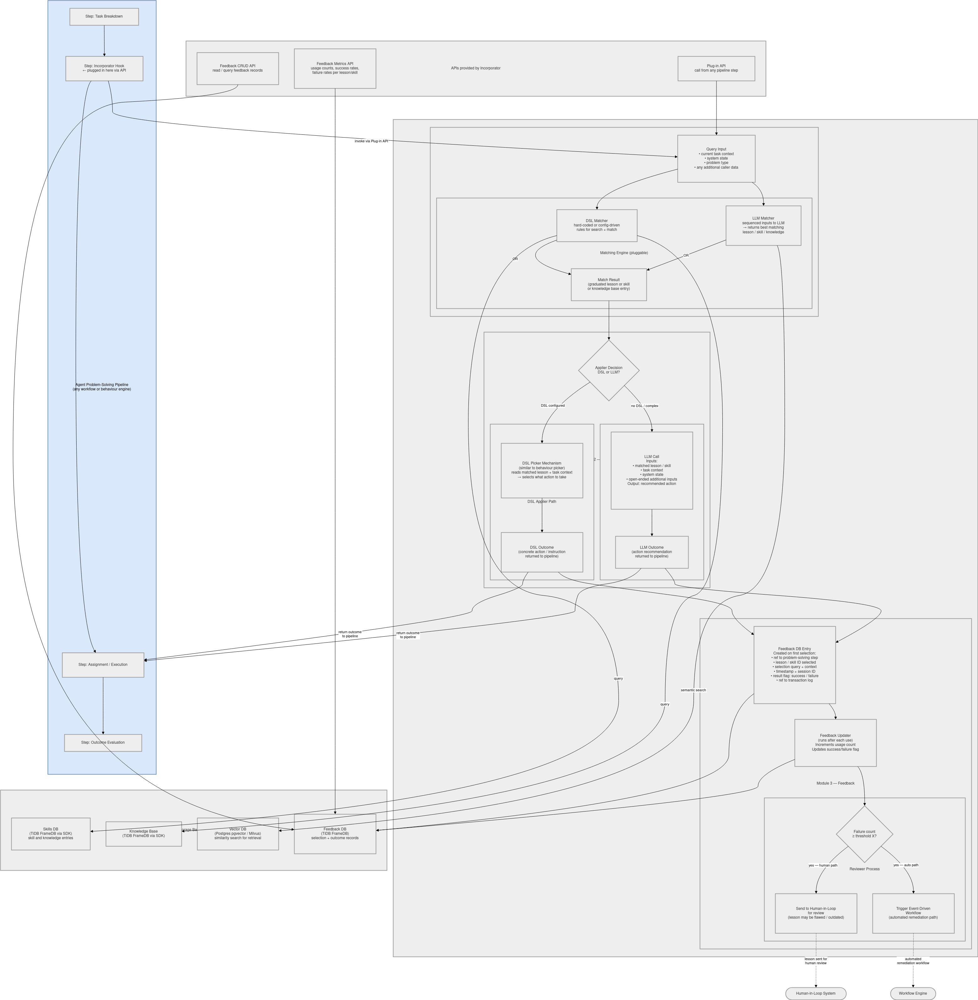

# Incorporator & Feedback

The **Incorporator** (`memorygrid_incorporator`, MemoryGrid "Process 3") is how agents *use* what the [Learner](learner.md) has learned. At a step of the agent's problem-solving pipeline it:

1. **matches** the current problem against the promoted lessons in the Skills store and the Knowledge Base;
2. **applies** the match, turning it into a concrete action for the pipeline to execute;
3. **records feedback** for that selection;

and, once the pipeline reports the outcome:

4. **updates feedback** and, if a lesson keeps failing, **escalates** it — back to human review and/or disabling it.



[Download Image](../../images/advanced-memories/feedback.png)

The Incorporator **imports the Learner package and reuses its storage, LLM client and review queue**. Both services must point at the same Skills/Knowledge Base storage (see [Sharing storage with the Learner](#sharing-storage-with-the-learner)).

---

## Running the Service

Requires Python ≥ 3.10 and the `Learner/` folder next to `Incorporator/`. The Learner package is found automatically through the sibling folder, an editable install, or `PYTHONPATH`.

```bash
cd agent-memories/Incorporator
uv venv --python 3.11 .venv && source .venv/bin/activate
pip install -r requirements.txt        # also installs ../Learner/requirements.txt
uvicorn memorygrid_incorporator.main:app --port 8001
```

### Configuration (environment variables)

All the [Learner variables](learner.md#configuration-environment-variables) apply too (`MG_TIDB_DSN`, `MG_VECTOR_BACKEND`, `MG_VECTOR_DSN`, `MG_LESSONS_ROOT`, `ANTHROPIC_API_KEY`, `MG_LLM_MODEL`, …). The Incorporator adds:

| Variable | Default | Description |
|---|---|---|
| `MG_FEEDBACK_TIDB_DSN` | `sqlite+aiosqlite:///./memorygrid_feedback.db` | Feedback DB (separate from the lesson store) |
| `MG_MATCH_STRATEGY_MODE` | `dsl_then_llm_fallback` | `dsl_only`, `llm_only`, `dsl_then_llm_fallback`, `llm_then_dsl_fallback`, `best_of_both` |
| `MG_DSL_MATCH_RULES_PATH` | `./config/dsl_match_rules.json` | DSL matcher rules |
| `MG_FAILURE_THRESHOLD_X` | `3` | Failures of one lesson that trigger escalation |
| `MG_REVIEWER_PATH_MODE` | `human_only` | `human_only`, `auto_only` or `both` |
| `MG_HIL_MODE` | `learner_in_process` | Human path target: `learner_in_process` or `http` |
| `MG_HIL_BASE_URL` | `http://localhost:8000` | External HIL service (when `MG_HIL_MODE=http`) |
| `MG_AUTO_REMEDIATION_MODE` | `disable_via_learner` | Auto path target: `disable_via_learner` or `http` |
| `MG_WORKFLOW_ENGINE_BASE_URL` | `http://localhost:9000` | External workflow engine (when `MG_AUTO_REMEDIATION_MODE=http`) |

---

## Plug-in API

### Invoke — `POST /incorporator/invoke`

Called by the host pipeline at its "Incorporator hook" step:

```bash
curl -X POST http://localhost:8001/incorporator/invoke -H "Content-Type: application/json" -d '{
  "session_id": "s1",
  "problem_solving_step_ref": "step-17",
  "problem_type": "flaky_upload",
  "current_task_context": {"operation": "upload report.pdf"},
  "system_state": {"storage_status": "degraded"},
  "additional_caller_data": {}
}'
```

**`QueryInput`:**

| Field | Required | Description |
|---|---|---|
| `session_id` | Yes | Pipeline session |
| `problem_solving_step_ref` | Yes | ID of the pipeline step (used again when reporting the outcome) |
| `problem_type` | Yes | Problem category; the key the DSL matcher's rules use |
| `current_task_context` | No | Task details (also used to fill instruction templates) |
| `system_state` | No | Environment state (given to the LLM applier) |
| `additional_caller_data` | No | Anything else (also used to fill instruction templates) |

**Response — `ApplierOutcome`:**

```json
{
  "id": "6f1c…",
  "source": "dsl",
  "action": "retry_with_backoff",
  "instruction": "Retry upload report.pdf with backoff",
  "recommended_action_payload": {"dsl_payload": {"action": "retry_with_backoff", "instruction_template": "Retry {operation} with backoff"}},
  "match_result": {
    "matched_entity_type": "skill",
    "matched_entity_id": "2b9e…",
    "matcher_used": "dsl",
    "confidence": 1.0,
    "raw_payload": { "...": "the promoted lesson" }
  },
  "created_at": "2026-10-22T10:00:00Z"
}
```

The pipeline executes `action` / `instruction`. If nothing matches, the response is **404**.

### Report outcome — `POST /incorporator/outcome`

Called after the pipeline evaluates the result:

```bash
curl -X POST http://localhost:8001/incorporator/outcome -H "Content-Type: application/json" \
  -d '{"problem_solving_step_ref": "step-17", "session_id": "s1", "result_flag": "failure"}'
```

`result_flag` is `success`, `failure` or `pending`. The latest feedback entry for that step and session is updated and returned. The response is **404** if `/incorporator/invoke` was never called for that step and session.

---

## Matching

The **Matching Engine** combines two matchers according to `MG_MATCH_STRATEGY_MODE`:

| Mode | Behaviour |
|---|---|
| `dsl_only` | DSL matcher only |
| `llm_only` | LLM matcher only |
| `dsl_then_llm_fallback` (default) | DSL first; LLM if DSL finds nothing |
| `llm_then_dsl_fallback` | LLM first; DSL if LLM finds nothing |
| `best_of_both` | Run both, keep the higher-confidence match |

### DSL matcher (deterministic, no LLM)

Rules map a `problem_type` to a bin and a lookup query. They are loaded from `MG_DSL_MATCH_RULES_PATH`, and no rules apply if the file is missing.

```json
{
  "rules": [
    {"problem_type": "flaky_upload", "target_bin": "skills_base", "query": "retry uploads", "min_score": 0.0},
    {"problem_type": "pricing_question", "target_bin": "knowledge_base", "query": "pricing tiers", "min_score": 0.3}
  ]
}
```

For the rule of the query's `problem_type`, the matcher searches that bin with `query` (or the problem type when no `query` is set) and takes the top hit. Search combines text match on title/body (score 1.0) with vector similarity. A hit scoring below `min_score` is ignored.

### LLM matcher

1. Builds a text query from `problem_type`, `current_task_context` and `additional_caller_data`.
2. Gets the 10 most similar promoted lessons from the vector store (both bins).
3. Asks the LLM to choose one (`{"lesson_id": ..., "confidence": ...}`). If the reply can't be parsed, or the LLM returns no choice, the top vector hit is used.

---

## Applying

The **Applier** chooses between two paths for the matched lesson:

| Path | When | Result |
|---|---|---|
| **DSL picker** | The lesson's `dsl_payload` has an `action` | `source: "dsl"`. `action` is taken from `dsl_payload.action`. `instruction` is `dsl_payload.instruction_template` formatted with `current_task_context` + `additional_caller_data`; the raw template is used if a placeholder is missing |
| **LLM applier** | Otherwise | `source: "llm"`. The LLM gets the lesson, task context, system state and extra data, and returns `{"action", "instruction"}`. If the reply can't be parsed, `action` is `apply_recommended_lesson` and `instruction` is the lesson title |

To make a lesson deterministic, give it a `dsl_payload` when you inject it into the Learner:

```json
"dsl_payload": {"action": "retry_with_backoff", "instruction_template": "Retry {operation} with backoff"}
```

---

## Feedback and Escalation

### Feedback entries

Each successful `invoke` creates a **`FeedbackDBEntry`** in the Feedback DB:

| Field | Description |
|---|---|
| `id` | Entry ID |
| `problem_solving_step_ref`, `session_id` | Pipeline step and session |
| `lesson_skill_id`, `matched_entity_type` | The matched lesson |
| `selection_query`, `selection_context` | The query and task context |
| `result_flag` | `pending` → `success` / `failure` |
| `usage_count` | 1 at selection, +1 per reported outcome |
| `transaction_log_ref` | ID of the `ApplierOutcome` |
| `timestamp`, `updated_at` | |

### Threshold escalation

When a reported outcome is a `failure`, the **Threshold Monitor** counts that lesson's failed feedback entries. When the count reaches `MG_FAILURE_THRESHOLD_X`, the **Reviewer Process** escalates according to `MG_REVIEWER_PATH_MODE`:

| Path | `learner_in_process` / `disable_via_learner` (default) | `http` |
|---|---|---|
| **Human path** (`human_only`, `both`) | The original lesson is set back to `pending_review`, logged with `runtime_failure_flagged`, and re-queued in the Learner's review queue. A human then approves, edits or rejects it with the [Learner review API](learner.md#human-review) | `POST <MG_HIL_BASE_URL>/hil/flagged-lessons` with `{"lesson_skill_id", "feedback_entry_id", "reason"}` |
| **Auto path** (`auto_only`, `both`) | The lesson is **disabled immediately**: deleted from the Skills store and the Knowledge Base (and the vector index), so it can no longer match | `POST <MG_WORKFLOW_ENGINE_BASE_URL>/events` with `{"event_type": "lesson_remediation", "payload": {"lesson_skill_id", "failure_count"}}` |

The `http` targets are external services you provide. The Learner does not implement `/hil/flagged-lessons`. Escalation runs again on every further failure once the threshold has been reached.

---

## Feedback APIs

| Method & Path | Description |
|---|---|
| `GET /feedback/?lesson_skill_id=&session_id=&result_flag=` | Query feedback entries (all filters optional) |
| `GET /feedback/{entry_id}` | One entry (404 if unknown) |
| `GET /feedback/metrics/usage?lesson_skill_id=` | Usage and success/failure/pending counts, overall and per lesson |
| `GET /feedback/metrics/success-rate?lesson_skill_id=` | Success rate (success / decided), overall and per lesson |
| `GET /feedback/metrics/failure-rate?lesson_skill_id=` | Failure rate, overall and per lesson |
| `GET /health` | `{"status": "ok"}` |

```json
// GET /feedback/metrics/usage
{
  "by_lesson": {"2b9e…": {"usage_count": 6, "success": 2, "failure": 1, "pending": 0,
                          "success_rate": 0.667, "failure_rate": 0.333}},
  "overall":   {"usage_count": 6, "success": 2, "failure": 1, "pending": 0,
                "success_rate": 0.667, "failure_rate": 0.333}
}
```

---

## Host Pipeline Integration

The package includes a reference client for host pipelines, `IncorporatorHookClient`:

```python
from memorygrid_incorporator.pipeline.incorporator_hook import IncorporatorHookClient

hook = IncorporatorHookClient("http://localhost:8001")

async def run_step(session_id, step_id, task):
    outcome = await hook.invoke(
        session_id=session_id,
        problem_solving_step_ref=step_id,
        current_task_context={"operation": task.name},
        system_state={"storage_status": "degraded"},
        problem_type=task.problem_type,
    )
    succeeded = await execute(outcome.action, outcome.instruction)   # your executor
    await hook.report_outcome(step_id, session_id, succeeded=succeeded)
```

`invoke` raises `httpx.HTTPStatusError` on a 404 (no match). Fall back to the agent's normal behaviour in that case.

---

## Sharing Storage with the Learner

The Incorporator builds its own copies of the Learner's storage objects from the same settings. For it to see the lessons the Learner promotes, both services must share:

* **the object store** — the same `MG_TIDB_DSN` (TiDB/MySQL, or the same SQLite file on one machine);
* **the vector store** — `MG_VECTOR_BACKEND=pgvector` or `milvus` with the same `MG_VECTOR_DSN`. The default `memory` backend is private to each process, so the LLM matcher wouldn't see the other service's lessons;
* **the lessons folder** — the same `MG_LESSONS_ROOT`.

With the default `learner_in_process` human path, a flagged lesson is re-queued in the **Incorporator's** in-process copy of the review queue. The flagged lesson's `pending_review` status is still stored in the shared object store, so it appears in the Learner's `GET /lessons/review/queue`.

---

## Programmatic Use

```python
from memorygrid_incorporator.api.deps import build_dependencies
from memorygrid_incorporator.config import Settings
from memorygrid_incorporator.incorporator.models import QueryInput
from memorygrid_incorporator.feedback.models import ResultFlag

deps = build_dependencies(Settings())

query = QueryInput(session_id="s1", problem_solving_step_ref="step-1", problem_type="flaky_upload",
                   current_task_context={"operation": "upload"})
match = await deps.matching_engine.match(query)
outcome = await deps.applier_service.apply(match, query)
await deps.feedback_recorder.record_selection(query, match, outcome)

entry = await deps.feedback_updater.update("step-1", "s1", ResultFlag.FAILURE)
await deps.threshold_monitor.check_and_escalate(entry)
```

`deps.learner_deps` is the Learner's full dependency container (stores, review service, …).
