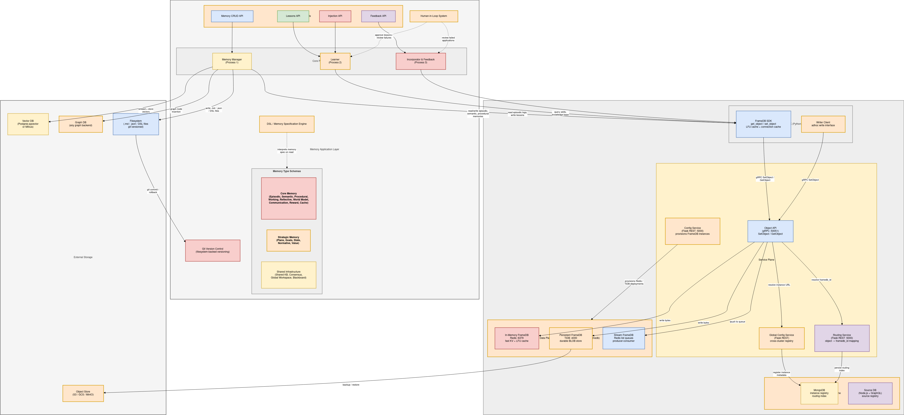
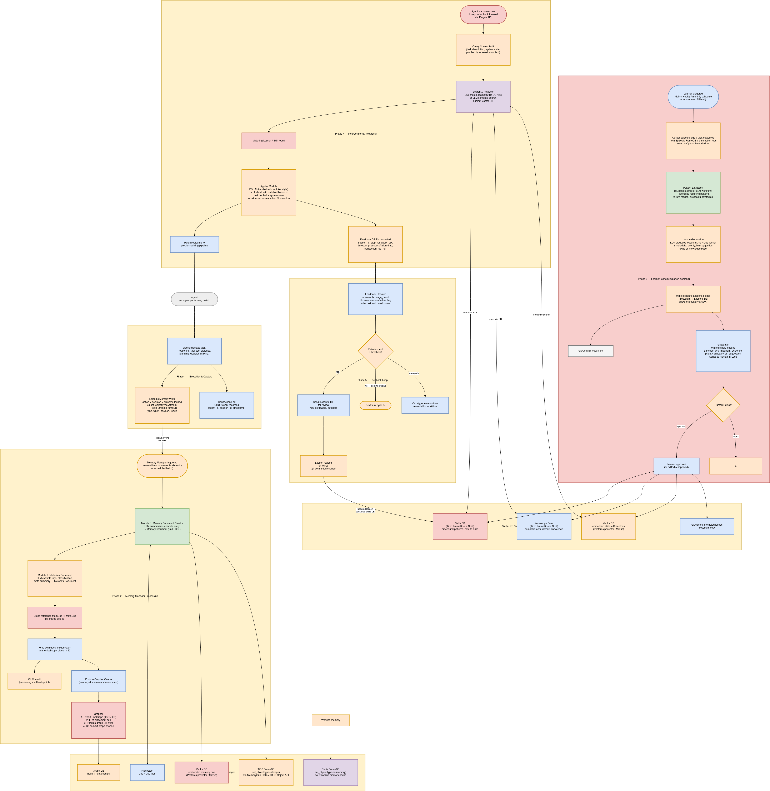

# Advanced Agent Memories

**Advanced Agent Memories** (the *MemoryGrid* stack) gives agents long-term memory and a way to learn from it. Agents can:

* **remember** what happened, what is true, how to do things, what they learned, and what worked;
* **mine lessons** from that experience on a schedule;
* have humans **review** those lessons before they are trusted;
* **apply** the trusted lessons when solving new tasks; and
* **track** whether applied lessons actually helped, retiring the ones that keep failing.

This section documents the `agent-memories` codebase, which contains four Python packages and the Kubernetes manifests for their databases.

---

## Components

| Component | Package / service | What it does | Docs |
|---|---|---|---|
| **Agentic Memory** | `agentic_memory` (library) | Six memory types — episodic, semantic, procedural, reflective, reward and session context — stored across PostgreSQL, Weaviate, ArangoDB and Redis behind one `AgentMemory` façade | [Agentic Memory](agentic-memory.md) |
| **Agent FS** | `agent_fs` (library) | A git-backed, version-controlled file system per agent: read/write files, commit, branch, tag, diff, restore, revert, stash | [Agent FS](agent-fs.md) |
| **Learner** | `memorygrid_learner` (FastAPI service) | Mines lessons from agent experience, accepts injected lessons, enriches them, runs human review, and promotes approved lessons into a **Skills** store or **Knowledge Base** (git-versioned) | [Learner](learner.md) |
| **Incorporator & Feedback** | `memorygrid_incorporator` (FastAPI service) | At task time, matches the current problem to a promoted lesson, turns it into a concrete action, records feedback, and escalates lessons that keep failing | [Incorporator & Feedback](incorporator.md) |

### Memory types at a glance

| Type | Question answered | Store | Docs |
|---|---|---|---|
| **Episodic** | What happened? | `mem.episodic` | [Episodic](episodic-memory.md) |
| **Semantic** | What is true? | `mem.semantic` | [Semantic](semantic-memory.md) |
| **Procedural** | How do I do this? | `mem.procedural` | [Procedural](procedural-memory.md) |
| **Reflective** | What did I learn? | `mem.reflective` | [Reflective](reflective-memory.md) |
| **Reward** | What works best? | `mem.reward` | [Reward](reward-memory.md) |
| **Context KV** | What is my current session state? | `mem.context_kv` | [Context KV](context-kv-memory.md) |

---

## Architecture



[Download Image](../../images/advanced-memories/overall.png)

The design has three core processes on top of the storage layer:

1. **Memory Manager** (Process 1) — turns raw input into memory documents and places them in a knowledge graph.
2. **Learner** (Process 2) — mines lessons from experience and graduates them through human review.
3. **Incorporator & Feedback** (Process 3) — applies lessons at task time and feeds results back.

### Memory lifecycle



[Download Image](../../images/advanced-memories/memory-lifecycle.png)

1. **Execution & capture** — the agent executes a task and records episodes (Agentic Memory).
2. **Memory processing** — memories are summarized, tagged and placed in a graph (Memory Manager — design only).
3. **Learning** — the Learner collects experience, extracts patterns, writes a lesson, enriches it, and sends it to human review. Approved lessons are promoted to the Skills DB or the Knowledge Base.
4. **Incorporation** — at the next task, the Incorporator matches the task to a promoted lesson and returns a concrete action.
5. **Feedback loop** — the outcome is recorded. A lesson that fails too often is sent back to human review and/or disabled.

### Implementation status

The diagrams describe the complete target design. What the code implements today:

| Design element | Status |
|---|---|
| Memory types (episodic, semantic, procedural, reflective, reward, context cache) | **Implemented** — `agentic_memory` |
| Git-versioned filesystem | **Implemented** — `agent_fs`, plus the Learner's own lessons repository |
| Learner Process: trigger, data collection, pattern extraction, lesson creation, watcher, enrichment, human review, promotion, cross-agent sharing, metrics | **Implemented** — `memorygrid_learner` |
| Incorporator: plug-in API, DSL/LLM matching, DSL/LLM applier, feedback DB, threshold escalation (human/auto paths), metrics | **Implemented** — `memorygrid_incorporator` |
| Memory Manager (memory document creator, metadata generator, grapher) | Design only ([diagram](../../images/advanced-memories/memory-manager.png)) |
| Team/org-level memory scopes, CRDT concurrent-write layer, shared workspace/blackboard/consensus ([diagram](../../images/advanced-memories/concurrency.png)) | Design only |
| FrameDB SDK (Redis/TiDB FrameDB via gRPC) | Not used by this code. The Learner talks to TiDB (or SQLite) directly through SQLAlchemy |
| Working memory, world model, strategic memory types | Design only |

Other diagrams: [Memory storage](../../images/advanced-memories/memory-storage.png) · [Learner process](../../images/advanced-memories/learner-process.png) · [Feedback](../../images/advanced-memories/feedback.png).

---

## How the pieces connect

```
                         ┌──────────────────────────── agent runtime ───────────────────────────┐
                         │                                                                       │
  task ─► Incorporator /invoke ──► action ──► agent executes ──► Incorporator /outcome           │
                │                                   │                     │                      │
                │ match against                     │ remember_episode()   │ failures ≥ X         │
                ▼                                   ▼                     ▼                      │
     Skills DB / Knowledge Base ◄── promote ── Learner ◄── collect ── Agentic Memory     re-review / disable
     (TiDB + vector + git)             ▲                                                         │
                                       └── human review (approve / edit / reject) ◄──────────────┘
```

* The **Learner** and the **Incorporator** share the same Skills/Knowledge Base storage. The Incorporator imports the Learner package and builds its storage objects from the same settings.
* **Agentic Memory** is the long-term memory library the agent uses directly. The Learner's data collection currently uses in-process demo sources. See [Learner → Feeding experience into the Learner](learner.md#feeding-experience-into-the-learner) for how to connect them.

---

## Getting Started

1. **Deploy the databases** for Agentic Memory: [Deployment](deployment.md).
2. **Give your agent memory:**

    ```python
    from agentic_memory import AgentMemory, MemoryConfig
    from agentic_memory.models import Outcome

    with AgentMemory(MemoryConfig()) as mem:
        ep = mem.remember_episode("Retried the upload with backoff and it succeeded",
                                  session_id="s1", agent_id="uploader", outcome=Outcome.SUCCESS)
        mem.reflect("Backoff fixes transient upload errors",
                    lesson="Retry uploads with exponential backoff", source_episode_id=ep.id)
        print(mem.recall("upload failures"))
    ```

3. **Run the Learner and the Incorporator** services, and connect your agent pipeline to them: [End-to-End Example](end-to-end.md).

---

## Contents

* [Agentic Memory](agentic-memory.md) — installation, configuration, embeddings, the `AgentMemory` façade, storage layout
    * [Episodic Memory](episodic-memory.md)
    * [Semantic Memory](semantic-memory.md)
    * [Procedural Memory](procedural-memory.md)
    * [Reflective Memory](reflective-memory.md)
    * [Reward Memory](reward-memory.md)
    * [Context KV Memory](context-kv-memory.md)
* [Agent FS](agent-fs.md) — git-backed agent file system
* [Learner](learner.md) — lesson mining, injection, review and promotion
* [Incorporator & Feedback](incorporator.md) — applying lessons and the feedback loop
* [Deployment](deployment.md) — databases on Kubernetes and running the services
* [End-to-End Example](end-to-end.md) — the full learn → apply → feedback loop
