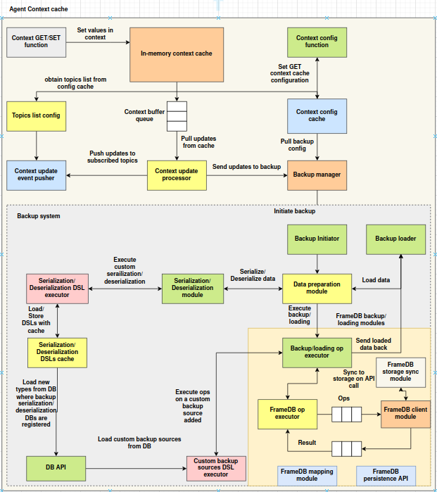

# Agent context cache

## Introduction

The **Agent Context Cache** is an event-driven, in-memory key-value store for agents. It is provided by the `agent_context_cache` package in `libs/agents-addons`. It offers:

* Fast **in-memory** storage for low-latency access
* Lightweight **namespace isolation** to scope key-value pairs
* A **buffered update system** that records every write as an operation and processes it on a background thread
* **NATS-based broadcasting** of context updates to a configurable list of topics
* A small **configuration store** (topics list, backup flag and backup settings) kept in the cache itself

It is useful for per-agent working state that other agents or services should be notified about.

---

## Architecture overview



[Download Image](../../images/agent-context-cache.png)

The diagram shows the full design, including a backup subsystem. The components implemented in `agent_context_cache.core` are described below. **Backup is not implemented yet:** the backup flag and settings can be stored and read, but no backup manager is wired in.

### 1. Context Interface and Primary Storage

All reads and writes go through `AgentContextCache.get` / `set` (and friends) to an **`InMemoryContextCache`**. It is a plain Python dict of namespaces, each holding key-value pairs. Reads are served from it directly. Data lives only in the process's memory and is lost on restart.

---

### 2. Configuration and Topic Management

**`ContextConfigurations`** stores the cache's runtime configuration as ordinary keys in the `config` namespace of the same in-memory cache:

| Key               | Meaning                                         |
| ----------------- | ----------------------------------------------- |
| `topics_list`     | NATS subjects that receive context updates      |
| `backup_enabled`  | Backup flag (stored only)                       |
| `backup_settings` | Backup settings dict (stored only)              |

**`TopicsListConfig`** is a thin wrapper that reads and updates the topics list.

---

### 3. Buffered Processing and Broadcasting

1. Every `set`, `delete` (of an existing key) and `clear_namespace` (of an existing namespace) records an operation in the **`ContextBufferQueue`**, a thread-safe queue. This includes writes to the `config` namespace.

    ```json
    { "operation": "set", "namespace": "default", "key": "user_profile", "value": { "name": "Alice" } }
    ```

2. The **`ContextUpdateProcessor`** runs on a daemon thread started by `AgentContextCache`. It takes operations from the queue one at a time and hands each to the **`ContextUpdateEventPusher`**.
3. The pusher connects to NATS at `nats://localhost:4222`, publishes the event to every topic in `topics_list`, and disconnects:

    ```json
    {
      "event_type": "context_update",
      "sender_subject_id": "<SUBJECT_ID env>",
      "event_data": { "operation": "set", "namespace": "default", "key": "user_profile", "value": { "name": "Alice" } }
    }
    ```

If no topics are configured, a warning is logged and nothing is published. Errors while publishing are logged, and processing continues with the next operation. Values must be JSON-serializable to be broadcast.

---

## Importing the context cache

The components live in `agent_context_cache.core`:

```python
from agent_context_cache.core.agent_context import AgentContextCache
```

| Component                  | Module                                   | Description                                                      |
| -------------------------- | ---------------------------------------- | ---------------------------------------------------------------- |
| `AgentContextCache`        | `agent_context_cache.core.agent_context` | Main class: wires the cache, configuration, queue, processor and pusher |
| `InMemoryContextCache`     | `agent_context_cache.core.cache`         | In-memory namespaced store that records operations               |
| `ContextStoreWrapper`      | `agent_context_cache.core.cache`         | `GET` / `SET` / `DELETE` / `CREATE_NS` wrapper around a cache    |
| `ContextConfigurations`    | `agent_context_cache.core.config`        | Configuration store in the `config` namespace                    |
| `ContextBufferQueue`       | `agent_context_cache.core.context_mgmt`  | Thread-safe queue of operations                                  |
| `ContextUpdateProcessor`   | `agent_context_cache.core.context_mgmt`  | Background processor that drains the queue                       |
| `TopicsListConfig`         | `agent_context_cache.core.topics_pusher` | Wrapper for managing the topics list                             |
| `ContextUpdateEventPusher` | `agent_context_cache.core.topics_pusher` | Publishes updates to NATS                                        |

Dependencies: `nats-py` (installed separately; it is not listed in `agent_addons`' `setup.py`).

> **Known issue:** `topics_pusher.py` contains `from .config import TopicsListConfig`, but `config.py` does not define `TopicsListConfig`. Importing `topics_pusher` — and therefore `agent_context`, which imports it — currently fails with `ImportError` until that line is removed.

---

## Usage

### Initialize

```python
from agent_context_cache.core.agent_context import AgentContextCache

ctx = AgentContextCache()
```

The constructor takes no arguments. It creates the in-memory cache and starts the update processor thread.

### Store and retrieve context values

```python
# Set a value in the default namespace
ctx.set("user_profile", {"name": "Alice", "age": 30})

# Retrieve it
profile = ctx.get("user_profile")
print(profile)  # {'name': 'Alice', 'age': 30}

ctx.get("missing")   # None
ctx.delete("user_profile")
```

### Use namespaces for scoped isolation

```python
ctx.set("session_token", "abc123", namespace="auth")
ctx.get("session_token", namespace="auth")  # 'abc123'
ctx.get("session_token")                    # None (default namespace)
```

### Manage keys and namespaces

```python
ctx.list_keys()                  # keys in the 'default' namespace
ctx.list_keys(namespace="auth")  # keys in 'auth'

ctx.list_namespaces()            # all namespaces, including 'config'

ctx.clear_namespace("auth")      # removes all keys in 'auth'
```

Namespaces are created automatically on first access (including `get` and `list_keys`).

### Configure topics and backup

```python
ctx.set_topics_list(["agent.context.updates"])   # must be a list (else ValueError)
print(ctx.get_topics_list())                     # ['agent.context.updates']

ctx.enable_backup()
ctx.set_backup_settings({"interval": 60})        # must be a dict (else ValueError)
print(ctx.is_backup_enabled())                   # True
print(ctx.get_backup_settings())                 # {'interval': 60}
ctx.disable_backup()
```

To add or remove single topics, use the configuration object directly:

```python
ctx.context_configurations.add_topic("agent.context.audit")
ctx.context_configurations.remove_topic("agent.context.audit")
```

### Shutdown

```python
ctx.shutdown()
```

> **Known issue:** `shutdown()` calls `update_processor.stop_processing()`, which does not exist. The method that stops the processor is `stop()`, and it only stops a thread started with `ContextUpdateProcessor.start()`. The processor thread is a daemon thread, so it ends when the process exits.

---

## Topics and Broadcasting

### How broadcasting works

1. A write (`set` / `delete` / `clear_namespace`) is applied to the in-memory cache.
2. The operation is queued.
3. The processor thread publishes a `context_update` event to every configured topic.

Each publish opens and closes its own NATS connection (`nats://localhost:4222`). The NATS URL is a `ContextUpdateEventPusher` constructor argument, but `AgentContextCache` always uses the default.

### Listening for updates

```python
import asyncio
import json
import nats


async def main():
    nc = await nats.connect("nats://localhost:4222")

    async def handler(msg):
        event = json.loads(msg.data.decode())
        op = event["event_data"]
        print(f"[{event['sender_subject_id']}] {op['operation']} {op['namespace']}/{op['key']} = {op.get('value')}")

    await nc.subscribe("agent.context.updates", cb=handler)
    await asyncio.Event().wait()

asyncio.run(main())
```

---

## Using the Building Blocks Directly

The components can also be composed by hand, for example to use a different NATS URL:

```python
from agent_context_cache.core.cache import InMemoryContextCache
from agent_context_cache.core.config import ContextConfigurations
from agent_context_cache.core.context_mgmt import ContextBufferQueue, ContextUpdateProcessor
from agent_context_cache.core.topics_pusher import TopicsListConfig, ContextUpdateEventPusher

queue = ContextBufferQueue()
cache = InMemoryContextCache(buffer_queue=queue)
config = ContextConfigurations(context_cache=cache)
pusher = ContextUpdateEventPusher(TopicsListConfig(config), nats_url="nats://nats.messaging:4222")

processor = ContextUpdateProcessor(buffer_queue=queue, event_pusher=pusher)
processor.start()      # background thread
# ...
processor.stop()
```

`InMemoryContextCache(buffer_queue=None)` works as a plain namespaced dict with no broadcasting.

---

## AgentContextCache Reference

| Method                                    | Description                                         |
| ----------------------------------------- | --------------------------------------------------- |
| `set(key, value, namespace="default")`    | Store a value (queued for broadcast)                |
| `get(key, namespace="default")`           | Get a value, or `None`                              |
| `delete(key, namespace="default")`        | Delete a key (queued for broadcast if it existed)   |
| `list_keys(namespace="default")`          | List keys in a namespace                            |
| `clear_namespace(namespace="default")`    | Clear a namespace (queued if it existed)            |
| `list_namespaces()`                       | List namespaces                                     |
| `set_topics_list(topics)` / `get_topics_list()` | Set / get broadcast topics                    |
| `enable_backup()` / `disable_backup()` / `is_backup_enabled()` | Backup flag (stored only)       |
| `set_backup_settings(settings)` / `get_backup_settings()` | Backup settings (stored only)        |
| `shutdown()`                              | See the known issue above                           |

Attributes: `cache`, `context_configurations`, `topics_list_config`, `buffer_queue`, `event_pusher`, `update_processor`.
