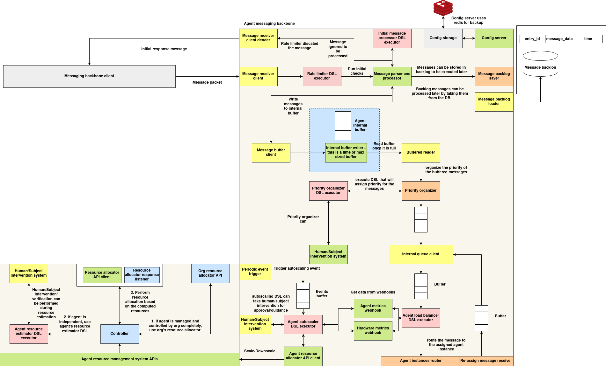

# Agent communication system

## Architecture



[Download Image](../../images/agent-communication.png)

Every deployed agent (subject) has one **agent executor** in front of its **agent instances**. The executor is the agent's single entry point. It receives tasks, applies the subject's policies, and dispatches each task to one instance. Instances process tasks with the agents SDK and send results back to wherever the task asked.

The diagram shows the overall design. This page describes what the agent executor (`services/agents/agents-executor`) and the agents SDK implement today.

```
              ┌──────────────────────────── Agent Executor (per subject) ────────────────────────────┐
HTTP /submitTask ─┐                                                                                    │
                  ├─► pre_process ─► Message Pre-check ─► Rate Limiter ─► Message Backlog ─► Load Balancer ─┼─► Redis "jobs:inbox"
P2P (NATS) ───────┘    (policy)          (policy)          (policy)          (policy)       │   of instance
<subject>__executor                                                                         │
              │                         Autoscaler (policy) ── scale up/down ──► Deployer /instances
              └─────────────────────────────────────────────────────────────────────────────────────┘

Agent instance: Redis BRPOP "jobs:inbox" ─► on_preprocess ─► on_data ─► result to output_ptr (Redis / exchange / mesh)
```

The system has three parts:

1. **Agent messaging backbone** — task intake and policy checks in the executor.
2. **Agent instance routing and load balancing** — choosing an instance and delivering the task.
3. **Agent resource management** — instance discovery and autoscaling.

All decision points are **policies** taken from the subject's `integrations.policies` (see [Agent Specification](../agent-specification.md)). Each is looked up by `policy_type`, and its code is loaded from the Policy DB (`POLICY_DB_URL`). A hook with no policy uses a built-in default.

---

## 1. Agent Messaging Backbone

### Message intake

The executor accepts tasks from two places:

| Entry point | Protocol | Notes |
|---|---|---|
| `POST /submitTask` | HTTP (port 9000, exposed as a NodePort) | Used by the Delegate API and by `context.direct` |
| NATS subject `<SUBJECT_ID>__executor` | P2P mesh | Messages must look like the HTTP body below. A message wrapped as `{"event": "custom_event", "event_data": {...}}` is unwrapped first; `join` / `remove` / `task_result` events are ignored |

**Task message:**

```json
{
  "event_type": "task",
  "task_id": "task-001",
  "task": { "text": "..." },
  "session_id": "sess-1",
  "origin": {
    "type": "redis",
    "host": "<redis host>",
    "port": 6379,
    "output_queue": "sess-1",
    "exchange_id": "delegate"
  }
}
```

`event_type` must be `"task"`; anything else is rejected (HTTP 500 / dropped on NATS). The executor converts the message into:

```json
{
  "session_id": "<new uuid>",
  "message_data": { "task_id": "task-001", "job_data": { "text": "..." }, "output_ptr": { ...origin... } }
}
```

> The executor assigns a **new random `session_id` to every message**; the `session_id` in the request is not used. Per-session policies (rate limiting, backlog) therefore see each message as its own session.

### Policy pipeline

Each message passes through these stages in order. The input to each policy is `{"session_id": ..., "message_data": ...}`.

| Stage | `policy_type` | Policy returns | Default (no policy) |
|---|---|---|---|
| **Message pre-check** | `message_prechecker` | `{"allowed": bool, "reason": {...}}` or a bool | allow |
| **Rate limiter** | `rate_limiter` | `{"allowed": bool, "metadata": {...}}` or a bool. The policy is given a `rate_counter` with per-session counters and metadata | allow |
| **Message backlog** | `message_backlog` | `{"backlogged": true, "reason": {...}}` to hold the message, or `{"backlogged": false, "messages": [...]}` to release one or more messages. The policy is given the `backlog_store` | release the message unchanged |

* If the pre-check rejects a message, the result is `blocked` at stage `pre_check`. If the rate limiter rejects it, the result is `blocked` at `rate_limit`. Over HTTP both return **429** with `stage` and `reason`.
* A backlogged message is acknowledged but not dispatched. The backlog policy decides when to release held messages.
* An exception inside any of these policies is treated as "allow / not backlogged".

**Storage backends:**

| Component | Env var | Values | Redis settings |
|---|---|---|---|
| Rate counter | `RATE_LIMITER_BACKEND` | `memory` (default) / `redis` | `REDIS_URL`, or `REDIS_HOST` / `REDIS_PORT` / `REDIS_PASSWORD` |
| Backlog store | `BACKLOG_BACKEND` | `memory` (default) / `redis` | `REDIS_URL` (required for redis); keys `backlog:<session_id>` |

### HTTP API

**`POST /submitTask`** — run the pipeline and dispatch:

| Result | HTTP | Body |
|---|---|---|
| Blocked | 429 | `{"success": false, "error": "blocked", "stage": "pre_check" \| "rate_limit", "reason": {...}}` |
| Ready / backlogged | 202 | `{"success": true, "message": "task received for processing", "result": {"status": "ready" \| "backlogged", ...}}` |
| Error | 500 | `{"success": false, "error": "..."}` |

**`POST /dryRun`** — run the pre-check, rate limiter and backlog decision without dispatching. The body is `{"session_id": "...", "message_data": {...}}` (`message_data.is_dry_run` is set to `true`). Returns 429 if blocked, `{"success": true, "message": "ok"}` if ready.

**`GET /healthz`** — `{"ok": true}`.

The `TaskInitiator` client in the SDK (`core.direct`) and the delegation proxy wrap these endpoints: `submit_task(...)`, `dry_run(...)` and `healthz()`. A 429 response raises `BlockedError(stage, reason)`.

---

## 2. Agent Instance Routing and Load Balancing

Messages released by the pipeline go to the **Load Balancer**, which runs on its own thread with an input queue.

1. For each message the `load_balancer` policy is called with `{"session_id", "message_data"}`. It is given `get_instances()` (current instance IDs) and the `load_balancer` object.
2. The policy returns the target instance as a string, `{"ok": true, "instance": "<id>", "metadata": {...}}`, or a `(instance_id, metadata)` tuple. The default picks a random instance.
3. The task (`message_data`: `task_id`, `job_data`, `output_ptr`) is `LPUSH`ed to the instance's Redis sidecar at `<instance_id>-<subject_id>.agents.svc.cluster.local:6379`, list `jobs:inbox` (override with `LB_REDIS_QUEUE_KEY`).

If the policy errors or returns no instance, the message is not delivered (it is only recorded internally).

### Agent instances

Each instance runs the agent code through the SDK (`core.main.main(AgentClass)`):

* A **Redis worker** `BRPOP`s tasks from `REDIS_STREAM` (default `jobs:inbox`) on `REDIS_URL` (default `redis://localhost:6379/0`, the sidecar).
* `AgentExecutor.process_task` runs optional transformer / pre-processing policies, then `on_preprocess`, then `on_data` for each returned task, then optional post-processing.
* Results are delivered according to the task's `output_ptr`:

| `output_ptr.type` | Delivery | Requires `exchange_id` |
|---|---|---|
| `redis` | `LPUSH` a JSON result to `output_queue` on `host:port` (used by the Delegate API) | yes |
| `exchange` | Submitted to the job exchange (`OutputReporter`) | yes |
| `mesh` | P2P reply to `sender_subject_id` (`internal_task_id` as task ID) | yes |

  Results without `output_ptr.exchange_id` are not delivered.

* The result body is `{"task_id", "job_output", "job_output_metadata", "job_output_trace_data", "is_error", "error_data"}`.
* If `on_preprocess` returns `None`, **no result is produced**, so a caller waiting on the result (for example `submit-and-wait`) keeps waiting.

Instances also run a WebSocket listener (`WS_PORT`, default 8765) for synchronous task calls; see [Chat and P2P](../agent-chat-p2p.md#other-ways-to-reach-an-agent).

---

## 3. Agent Resource Management

### Instance discovery

`AgentsUpdateNotifier` watches pods in the `agents` namespace with label `subjectId=<SUBJECT_ID>`. It reports their `instanceId` labels to the load balancer whenever the set changes, and on a periodic refresh.

### Autoscaler

When `DEPLOYER_API_URL` is set, the executor runs an **AutoScaler** thread every 30 seconds:

1. It builds the state `{"instance_count", "instance_ids", "queue_depth", "subject_id"}`, where `queue_depth` is the load balancer's input queue size.
2. It calls the `autoscaler` policy, which is given `get_instances()` and `get_queue_depth()`.
3. The policy returns `"scale_up"`, `"scale_down"` or `None` (or `{"action": ...}`). The default is no action.
    * **scale_up** — `POST <DEPLOYER_API_URL>/instances` with `{"subject_id", "count": 1, "meshes", "delegate_api_url"}` (`delegate_api_url` comes from `AGENT_DELEGATE_URL`).
    * **scale_down** — `DELETE <DEPLOYER_API_URL>/instances` with `{"subject_id", "instance_ids": [<last instance>]}`.

> The deployer currently starts executors with `SUBJECT_ID`, `SUBJECT_DB_URL`, `POLICY_DB_URL` and `MESH_LIST` only. Without `DEPLOYER_API_URL` the autoscaler is disabled (a warning is logged).

### Deployer instance API

| Method & Path | Body | Description |
|---|---|---|
| `POST /instances` | `{"subject_id", "count", "meshes", "delegate_api_url"}` | Create `count` instances with random 5-character IDs |
| `DELETE /instances` | `{"subject_id", "instance_ids": [...]}` | Remove instances |

---

## Executor Configuration

| Environment variable | Required | Description |
|---|---|---|
| `SUBJECT_ID` | Yes | Subject served by this executor |
| `SUBJECT_DB_URL` | Yes | Subjects service (the subject spec and its policies are loaded at start-up) |
| `POLICY_DB_URL` | Yes | Policy DB used to load policy code |
| `MESH_LIST` | No | `{"meshes": [{"mesh_id", "url"}]}` for P2P intake |
| `RATE_LIMITER_BACKEND`, `BACKLOG_BACKEND`, `REDIS_URL`, `REDIS_HOST`, `REDIS_PORT`, `REDIS_PASSWORD` | No | Policy state storage (see above) |
| `LB_REDIS_QUEUE_KEY` | No | Instance queue name (default `jobs:inbox`) |
| `DEPLOYER_API_URL` | No | Enables the autoscaler |
| `AGENT_DELEGATE_URL` | No | Passed to instances created by the autoscaler |

---

## Related Services

* **Delegation proxy** (`delegation-system/delegation-proxy`) — `POST /api/submit-and-wait` looks up the agent's executor URL in runtime subjects (`RUNTIME_SUBJECTS_API_URL`), submits the task with a Redis `origin` whose `output_queue` is the session ID, and waits (`BRPOP`, no timeout) for the result. The response is `{"success": true, "ack": {...}, "output": <result body>}`. `GET /healthz` reports health.
* **Chat server** — a WebSocket front-end that forwards chat messages to the Delegate API; see [Agent Chat Server](../agent-chat-p2p.md#agent-chat-server-client-developer-documentation).
* **P2P meshes** — presence and events between agents; see [Agent P2P Module](../agent-chat-p2p.md).
